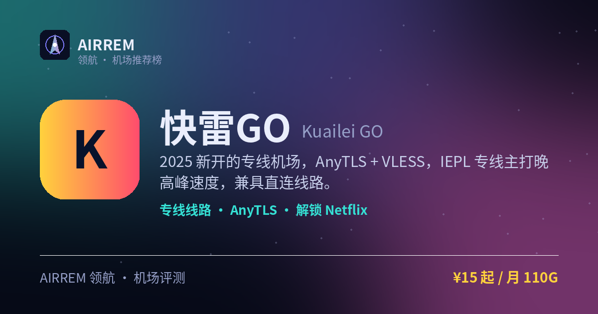

# 快雷GO机场评测 2026：专线加速 · 全设备档，官网注册入口与套餐价格

> 一句话总结：海外专线加速、最高 1000Mbps，全流媒体解锁；设备档从 2 台到 100 台全覆盖，个人 / 家庭 / 工作室都有对应包，另有不限时流量包可单买

👉 **[快雷GO 官网注册入口](https://t.rtxk.us/t/cp2d6j8)** ｜ [完整评测与横向对比](https://555736.xyz/kuailei/)

---

## 基本信息

| 项目 | 内容 |
| --- | --- |
| 机场名称 | 快雷GO（快雷狗 / 快雷Go） |
| 成立时间 | 2025 |
| 线路类型 | IEPL 专线 + 直连 |
| 支持协议 | AnyTLS / VLESS |
| 流媒体解锁 | Netflix / Disney+ / ChatGPT / TikTok |
| 节点地区 | 香港 · 日本 · 台湾 · 美国 · 新加坡 · 马来西亚 等 |
| 计费方式 | 月付(订单日重置) / 不限时流量包 |
| 起步价格 | ¥20 / 月 150G |
| 推荐场景 | 冲海外专线速度、个人到团队多设备 |

## 快雷GO 是什么

快雷GO（部分测评写作「快雷狗」）是 2025 年上线的一家专线机场，主打晚高峰时段的速度体验。它采用 AnyTLS + VLESS 协议组合，线路以 IEPL 专线为主并搭配直连，落地节点覆盖香港、日本、台湾、美国、新加坡、马来西亚等常用地区。

## 线路与节点

IEPL 专线全程内网，理论上晚高峰更抗拥堵；部分节点提供直连线路。落地 ISP 较为多样，节点数量 50+，兼顾常用地区与少量小众线路。多家测评把快雷GO 归入「晚高峰速度较快」的一档。

## 协议与客户端

采用 AnyTLS 与 VLESS 协议，兼容 Clash 系、Shadowrocket、sing-box 等支持新协议的主流客户端，导入订阅即可使用。

> 💡 AnyTLS/VLESS 需要较新版本客户端，老客户端可能不支持，导入前建议更新到最新版。

## 解锁能力

官方标注支持 TikTok、推特、Instagram、YouTube、Netflix、Disney+、ChatGPT 等主流流媒体与 AI 服务解锁，日常追剧、社交与 AI 工具场景基本一网打尽。

## 快雷GO 套餐价格

| 套餐 | 价格 | 说明 |
| --- | --- | --- |
| 小包（入门体验） | ¥20 | 月付 · 每月 150G · 200Mbps · 2 台设备 |
| 中包（热卖推荐） | ¥36 | 月付 · 每月 300G · 500Mbps · 3 台设备 |
| 大包（重度 / 家庭） | ¥60 | 月付 · 每月 800G · 1000Mbps · 10 台设备 |
| 旗舰包（工作室 / 团队） | ¥195 | 月付 · 每月 3000G · 1000Mbps · 100 台设备 |
| 流量包 300G | ¥139 | 不限时买断 · 300G 用完为止 · 1000Mbps · 10 台设备 |
| 流量包 1000G | ¥269 | 不限时买断 · 1000G 用完为止 · 1000Mbps · 10 台设备 |

> 月付套餐每月按订单日重置流量，速度与设备数随档位递增（200→1000Mbps、2→100 台）；流量包为不限时一次性买断、可单独购买；全线海外专线，价格以官网实时为准。

## 优点与缺点

**✅ 优点**

- 全线海外专线加速，最高 1000Mbps，速度阶梯清晰
- 设备档从 2 台到 100 台全覆盖，个人到工作室 / 团队都合适
- 全流媒体解锁：tiktok/ins/油管/奈飞/迪士尼/ChatGPT
- 另有 300G/1000G 不限时流量包可单买，防失联

**⚠️ 缺点**

- 2025 年新机场，运营时间尚短
- 新协议需较新客户端支持
- 公开长期实测有限，稳定性待观察
- 建议先月付小档，别大额年付

## 适合谁 / 不适合谁

| 👍 适合 | 👎 不适合 |
| --- | --- |
| 看重海外专线速度、要跑满带宽的用户 | 只信老牌、要长期实测数据 |
| 多设备 / 家庭 / 工作室 / 团队需要大设备数的用户 | 客户端较老、不便升级的用户 |
| 想单买不限时流量包做长期备用的用户 |  |

## 我们的结论

快雷GO（也写作快雷狗）主打「快」：全线海外专线、速度阶梯清晰（200→500→1000Mbps），tiktok/ins/油管/奈飞/迪士尼/ChatGPT 一网打尽。最实用的是设备档位——小包 2 台、中包 3 台、大包 10 台、旗舰包 100 台，从个人一路覆盖到工作室 / 团队；还有 300G/1000G 不限时流量包可单独买来防失联。作为 2025 新站，建议先月付小档验证晚高峰稳定性，别一上来大额年付。

## 常见问题

**Q：AnyTLS 协议是什么？我的客户端能用吗？**

A：AnyTLS 是一种较新的抗封锁传输协议，需要较新版本的客户端（如新版 Clash.Meta / sing-box / Shadowrocket）才能识别。导入订阅前请先把客户端更新到最新版；若不支持，可改用节点提供的 VLESS 协议。

**Q：快雷GO 是新机场，靠谱吗？**

A：它 2025 年才上线，运营时间还短。稳妥做法是先买月付或最低档验证晚高峰稳定性，别一上来大额年付，同时再备一两家机场互为容灾。

## 同类机场推荐

拿不定主意？可以再看看这几家同类型的：

- **[西部数据](https://555736.xyz/westdata/)** — 稳定专线党，¥17 起
- **[糖果云](https://555736.xyz/candycloud/)** — 影视追剧旗舰，¥18 起
- **[红杏云](https://555736.xyz/hongxing/)** — 流媒体 / 大流量性价比，¥20 起

全部 38 家机场的横向对比与选购方法论：**[信号塔 SignalTower · 机场大全](https://555736.xyz/airports/)**

---

数据更新：2026-07 ｜ 价格、套餐与优惠码以官网实时为准 ｜ 本仓库为第三方评测整理，与 快雷GO 官方无隶属关系 ｜ 请遵守当地法律法规使用网络服务。

关键词：快雷GO、快雷狗、Kuailei、海外专线、AnyTLS、VLESS、专线加速机场、多设备机场、不限时流量包、机场推荐、机场评测、Netflix解锁、ChatGPT
